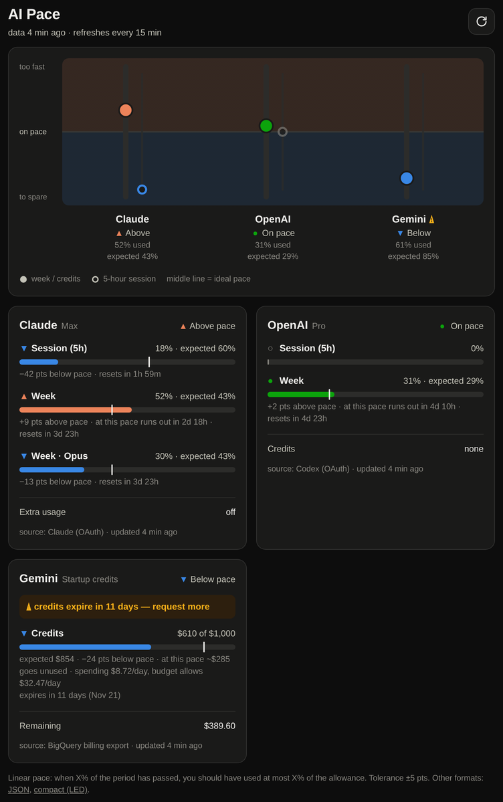
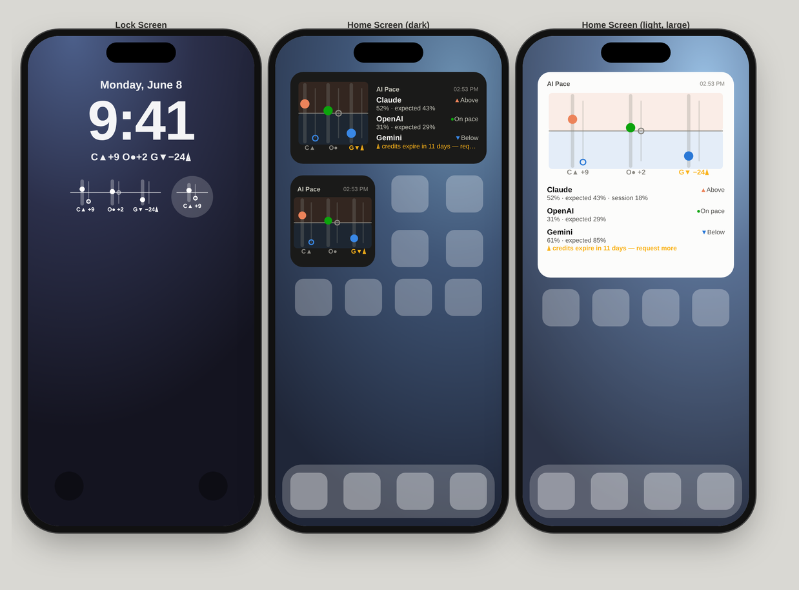

# AI Pace

**Are you burning through your AI plan too fast?** AI Pace answers that with one dot per tool.

Claude, ChatGPT/Codex and Google Cloud each show raw percentages ("34% of your weekly limit used"), but a
percentage alone doesn't tell you whether you're fine. 34% on Tuesday is a problem; 34% on Saturday is not.
AI Pace compares how much you've **used** with how much of the period has **passed**: one column per tool,
a dot for what you've used and a dash for what you should have used by now.

```
        Claude   OpenAI   Gemini
100% ┬    │        │        │
     │    │        │        │
 75% ┤    │      ━━┿━━    ━━┿━━     ━━ expected by now
     │    │        │        │
 50% ┤    ●        │        │        ● used
     │  ━━┿━━      │        ●
 25% ┤    │        ●        │        dot above the dash: too fast, slow down
     │    │        │        │        dot below the dash: room to spare
  0% ┴    │        │        │                (for credits: they'll expire unused)
```

One small self-hosted server collects the data every 15 minutes and serves it to several front-ends:
a **web dashboard / PWA**, an **iPhone widget** (Home Screen and Lock Screen), a **macOS menu bar** item,
a **Waybar** module for Linux, and a compact JSON endpoint ready for an **LED display**.

| Web dashboard | iPhone widgets |
|---|---|
|  |  |

<sub>Screenshots use the built-in demo data (`npm run demo`).</sub>

## How pace works

Linear pace: when X% of the period has passed, you should have used at most X% of the allowance.

- Your weekly limit resets on Sunday and today is Tuesday: ~2/7 of the week has passed, so the expected
  usage is **29%**. If you've used 45%, you're **16 points above pace**: at this rate you'll hit the limit
  before the reset.
- $1,000 of cloud credits for 3 months: after one month you should have spent about $333. If you spent $150
  you're **below pace**: credits will expire unused, so you can use more.

Every meter shows used %, expected %, the difference in points, a projection ("at this pace runs out in 2d 18h")
and when it resets. Within ±5 points (`PACE_TOLERANCE`) counts as on pace; nothing used once the period has
started counts as below pace.

| Symbol | Meaning | Color |
|---|---|---|
| ▲ | above pace, slow down | orange |
| ● | on pace | green |
| ▼ | below pace, room to spare | blue |
| ■ | limit reached | red |
| ○ | nothing to track right now (e.g. no 5-hour session open) | gray |
| ⚠ | action needed (e.g. credits expire in 15 days: time to request more) | yellow |

Shape and position carry the meaning on their own (dot above or below the dash); color only reinforces it.
That's also why it works on the monochrome iPhone Lock Screen.

## What it tracks

| Provider | Meters | Source |
|---|---|---|
| **Claude** (Pro/Max) | 5-hour session, week, per-model weekly limits, extra usage | the same endpoint Claude Code's `/usage` reads, with your Claude Code OAuth login |
| **OpenAI** (ChatGPT plan with Codex) | 5-hour session, week, credits | the same endpoint the Codex CLI's `/status` reads, with your Codex login |
| **Gemini / Google Cloud credits** | credits spent vs. the credit period, expiry and renewal alert | Cloud Billing budget notifications (Pub/Sub), the BigQuery billing export, or a value you enter |

Claude usage is shared between claude.ai, the mobile apps and Claude Code, so the server sees all of it.

## Architecture

```
 Claude  (OAuth) ─┐                                  ┌─► /api/v1/status    web / PWA, iPhone widget
 OpenAI  (OAuth) ─┼─► AI Pace server ───────────────┼─► /api/v1/swiftbar  macOS menu bar
 Google  (GCP)   ─┘   Node, zero runtime deps       ├─► /api/v1/waybar    Waybar (Linux)
                      data/state.json                └─► /api/v1/compact   LED / microcontrollers
```

- Node ≥ 22.18 runs the TypeScript directly: no build step and **no runtime dependencies** (only `node:` built-ins).
  It runs happily on a Raspberry Pi.
- Raw readings are stored in `data/state.json`; pace is recomputed on every read, so "expected" keeps moving
  between data refreshes.
- Provider tokens never leave the server; the API only returns percentages and amounts.

## Quick start

```bash
git clone https://github.com/danicuki/ai-status-dashboard.git && cd ai-status-dashboard
cp .env.example .env      # set the providers you want (all optional)
npm run check             # fetch everything once and print the pace in the terminal (no server)
npm start                 # start the server on :8787
npm run token             # print the API token the clients need
```

Then open `http://localhost:8787/#token=YOUR_TOKEN` (the browser remembers it).

No credentials at hand? `npm run demo` starts a server with fake data at `http://localhost:8788/#token=demo`,
handy to try the widget and the plugins.

## Setting up the providers

### Claude (Pro/Max: 5-hour session and weekly limits)

AI Pace uses Claude Code's OAuth login and reads the same endpoint as its `/usage` screen. Two modes:

| | `shared` (default) | `dedicated` (recommended for a server) |
|---|---|---|
| Credentials | `~/.claude/.credentials.json`, your everyday login | a separate login only for AI Pace |
| Refreshes the token? | **never** (read-only) | yes, and writes it back |
| Up to date 24/7? | only while you use Claude Code (tokens last a few hours) | yes |

`shared` deliberately never refreshes: refresh tokens rotate, so refreshing from the server would sign your
Claude Code out. For a dedicated login:

```bash
CLAUDE_CONFIG_DIR=~/.config/ai-pace/claude claude auth login
```

```ini
# .env
CLAUDE_TOKEN_MODE=dedicated
CLAUDE_CREDENTIALS_FILE=~/.config/ai-pace/claude/.credentials.json
```

> Tokens from `claude setup-token` **don't work**: they lack the `user:profile` scope the usage endpoint needs.
> On macOS, Claude Code stores the login in the Keychain rather than a file; create the dedicated login on the
> Linux box or Raspberry Pi that runs the server.

### OpenAI (Codex limits on a ChatGPT plan)

Same idea, with the Codex CLI login (`~/.codex/auth.json`) and the endpoint behind Codex's `/status`.
Dedicated login:

```bash
CODEX_HOME=~/.config/ai-pace/codex codex login
```

```ini
CODEX_TOKEN_MODE=dedicated
CODEX_AUTH_FILE=~/.config/ai-pace/codex/auth.json
```

### Gemini / Google Cloud credits

Copy the active credit from **console.cloud.google.com/billing → Credits**:

```ini
GEMINI_CREDIT_TOTAL=1000          # original value
GEMINI_CREDIT_CURRENCY=USD
GEMINI_CREDIT_START=2026-10-01
GEMINI_CREDIT_END=2027-01-01      # or GEMINI_CREDIT_MONTHS=3
GEMINI_RENEW_DAYS=15              # ⚠ alert this many days before expiry
```

Google Cloud has **no public API that returns spend or remaining credits** (the Cloud Billing API only covers
accounts and the price catalog). AI Pace offers three ways to get the amount spent:

**1. Budget notifications via Pub/Sub (recommended, automatic).** The only official near-real-time signal:
Cloud Billing publishes a budget's current spend several times a day. Run the setup script once on any machine
where `gcloud` is logged in as a billing admin (read it first; it shows the plan and asks before changing anything):

```bash
npm run setup:gcp          # or: bash scripts/setup-gcp-budget.sh
```

It creates two notification-only budgets on the **billing account** (all projects, no thresholds, no emails),
"AI Pace (gross)" and "AI Pace (net)", whose difference is exactly the promotional credits consumed; a Pub/Sub
topic + subscription in a host project of your choice (only where those resources live); and a service account
that can **only** read that subscription. It prints the `.env` lines for the server and the key to copy there.
Run it again when you get a new credit. Google sends the first update within a few hours.

**2. BigQuery billing export (automatic, more setup).**
  1. Billing → **Billing export → BigQuery** → enable "Standard usage cost" into a dataset. The table
     `gcp_billing_export_v1_XXXXXX_XXXXXX_XXXXXX` appears after a few hours. This step is console-only.
  2. Create a service account with **BigQuery Data Viewer** (on the dataset) and **BigQuery Job User** (on the
     project), and download a JSON key.
  3. Configure `GCP_BILLING_TABLE`, `GCP_SERVICE_ACCOUNT_FILE` and optionally `GCP_BILLING_PROJECTS`.

  It sums the promotional credits (`PROMOTION`) consumed in the period (`GCP_CREDIT_MEASURE=cost` sums the
  gross cost instead). The export is not retroactive; put earlier spending in `GEMINI_CREDIT_USED_OFFSET`.

**3. Manual.** Type the amount used in the Gemini card on the dashboard now and then (or `GEMINI_CREDIT_USED`).

## Reaching it from your phone

The simplest private option is [Tailscale](https://tailscale.com): with the Tailscale app on your iPhone,

```bash
tailscale serve --bg 8787     # https://<machine>.<tailnet>.ts.net, only reachable inside your tailnet
```

Use that URL in the widget and set it as `PUBLIC_URL`. Avoid exposing the server to the internet; if you do,
the API token is the only thing protecting it.

## Front-ends

### Web dashboard / PWA

Open `https://your-server/#token=YOUR_TOKEN` once (the token is then kept in the browser and removed from the
address bar). On iPhone: Safari → Share → **Add to Home Screen**. `?theme=dark` or `?theme=light` forces a
theme, e.g. for a wall-mounted tablet.

### iPhone widget (Home Screen and Lock Screen)

1. Install **Scriptable** (free) and create a script with the contents of [`clients/ios/AI Pace.js`](clients/ios/AI%20Pace.js).
2. Run it once in the app: it asks for the server URL (https only) and the token, and stores them in the
   iPhone Keychain.
3. Add a **Scriptable** widget and pick the "AI Pace" script:
   - Home Screen: small (chart), medium (chart + summary), large (chart + details);
   - Lock Screen: rectangular (all providers), circular (one provider; set the widget parameter to `claude`,
     `openai` or `gemini`, or leave it empty for the worst one) and inline (`C▲+9  O●+2  G▼−24⚠`).

The script makes a single HTTPS request to your server, never follows redirects, reads no personal data and
never runs remote code; it keeps only short, type-checked fields from the response. Offline, it shows the last
data marked "offline".

### macOS menu bar

1. Install [SwiftBar](https://swiftbar.app) (`brew install swiftbar`).
2. Copy [`clients/macos/ai-pace.5m.sh`](clients/macos/ai-pace.5m.sh) into the plugin folder, set `AIPACE_URL`
   and `AIPACE_TOKEN`, and `chmod +x` it.

The menu bar shows `C▲ O● G▼`; the menu has the details. On macOS Sonoma or later, iPhone widgets can also be
placed on the Mac desktop.

### Linux: Waybar (Hyprland / Sway / omarchy)

See [`clients/waybar/README.md`](clients/waybar/README.md).

## Where to run the server

| Option | Good for |
|---|---|
| **Your computer** (`npm start`, or the systemd unit in [`deploy/ai-pace.service`](deploy/ai-pace.service)) | getting started, `shared` mode |
| **Raspberry Pi / home server** (`docker compose up -d --build`) | 24/7 with dedicated logins; the same Pi can drive an LED display |
| VPS / cloud | works, but `chatgpt.com` may block datacenter IPs (the error says so); prefer a home network or push mode |

**Push mode:** if the server lives elsewhere and your credentials on your laptop, run the collector locally;
it sends only the percentages:

```bash
# cron, every 15 min:  */15 * * * *  cd ~/ai-status-dashboard && npm run push --silent
AIPACE_URL=https://your-server AIPACE_TOKEN=xxx npm run push
```

## API

Every route requires `Authorization: Bearer <token>`.

| Route | Purpose |
|---|---|
| `GET /api/v1/status` | everything: providers, meters, pace, projections, alerts and ready-made texts |
| `GET /api/v1/compact` | minimal payload for microcontrollers (`status`, `gauge` −1…+1, `used`, `expected`, `color`, `alert`) |
| `GET /api/v1/swiftbar` | SwiftBar/xbar text format |
| `GET /api/v1/waybar` | Waybar JSON format |
| `POST /api/v1/refresh` | fetch from the providers now |
| `PUT /api/v1/manual/gemini` | `{"used": 312.5}`: amount used, manual mode |
| `POST /api/v1/ingest` | `{"snapshots": [...]}`: data from push mode |
| `GET /healthz` | no auth; for monitoring |

`used` and `expected` (0–100) are what the charts plot. `gauge` is the deviation squashed into −1…+1
(`tanh(delta / 25)`), handy for a single LED or a needle.

## Configuration

All settings are environment variables; [`.env.example`](.env.example) documents every one. Server-generated
text uses `LOCALE` (default `en-US`) for numbers, money and dates; the dashboard uses the browser's locale.

## Security notes

- Tokens for Claude, OpenAI and Google never leave the server. The API returns no secrets, and the API token
  only allows reading percentages, triggering a refresh, setting the manual credit value and pushing
  usage data (push mode). It is only accepted in the `Authorization` header, never in URLs.
- `data/state.json` and dedicated login files are written with mode `600`. Keep `.env` and `data/` out of git
  (they are in `.gitignore`).
- The API token is never printed in logs; `npm run token` shows it.
- Use HTTPS (e.g. `tailscale serve`). The iPhone widget refuses plain `http://`.

## Limitations

- The Claude and Codex usage endpoints are the ones their official CLIs use, but they are **not documented
  public APIs** and may change. The parsers accept every shape seen so far (including Claude's newer `limits[]`)
  and show a clear error on the card if something changes.
- Google Cloud credits: no public API exposes them, hence budget notifications, BigQuery or manual entry.
  Budget data lags Google's own billing by a few hours, like the console.
- iOS does not allow web pages to install widgets, and no app can place a widget for you: adding the widget
  is always a manual long-press → "+" step.

## Roadmap

- **LED display:** `/api/v1/compact` already has what a Ulanzi TC001 (AWTRIX 3), a Raspberry Pi with a HUB75
  matrix or an ESP32 with a WS2812 strip needs.

## Development

```bash
npm test          # pace math, parsers, end-to-end server with fake providers, iPhone widget in a Scriptable simulator
npm run typecheck
npm run dev       # server with reload
npm run demo      # fake data on :8788
```

```
src/
  server.ts  cli.ts  demo.ts       entry points
  pace.ts                          the pace math
  providers/  claude.ts openai.ts gemini.ts
  status.ts  render.ts  http.ts    API and output formats
public/                            web dashboard (plain HTML/CSS/JS)
clients/   ios/  macos/  waybar/   front-ends
test/      including a Scriptable API simulator to test the iPhone widget under Node
```

AI Pace is not affiliated with Anthropic, OpenAI or Google. It only reads your own usage with your own logins.

## License

[MIT](LICENSE)
